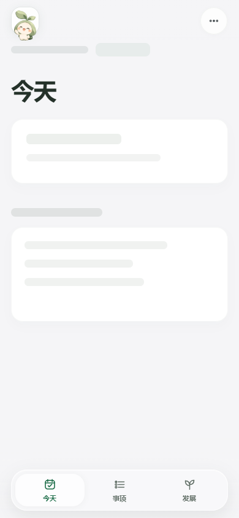
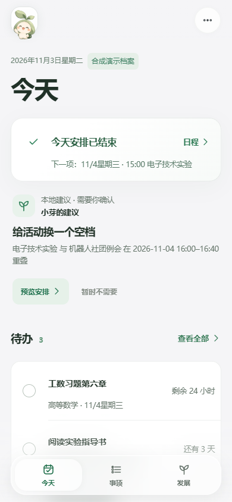
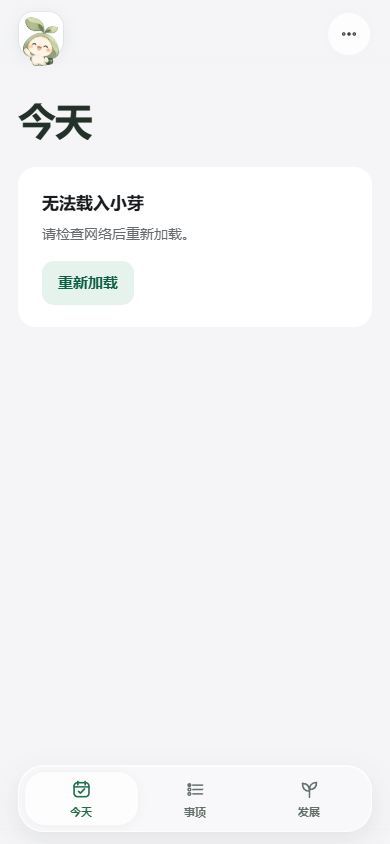

# 小芽 Native V4｜慢加载首屏与失败降级修复
**日期：2026-11-03** · 本轮干净工作树 `feature/xiaoya-v4-continuity-a11y-20261103` · 基于独立仓库 `ndshuge/xiaoya-lifelab/main@1899604`

## 问题来源与设计依据

正式 V4 的 `index.html` 原先只有空的 `<main id="workspace"></main>`。首次加载入口所需的 JS ES module（还会导入子模块）时，实际内容在 `app.mjs` 结尾调用 `render()` 之前为空。网络慢、缓存未命中或模块请求失败时，用户只会看到头像、顶栏和 Dock，中间是空白。这不是布局失误，也不能靠增强毛玻璃掩盖。

- **P1 初始内容不连续**：苹果式内容优先要求首屏在载入时也有明确层级。使用与真实「今天」页面保持相近的标题和中性结构占位；不生成虚构任务、DDL、心情和统计。没有不必要的 shimmer 动画。
- **P0 模块错误无反馈**：如果模块加载失败，应该提供可点击的重新加载入口，并保留 `?judge=1` 等原查询串。
- **P1 辅助功能**：载入时 `aria-busy=true`，成功/失败后显式结束 busy；系统「减少动效」下完全不做占位动画。
- **P2 维护**：复用原有纯 HTML + CSS + ES Modules，未引入 React、JS 动画包或 SVG 折射。L1 Dock 及现有动效由此前 `1899604` 的正式基线继续承载。

研究对照：
- [Apple HIG · Materials](https://developer.apple.com/design/human-interface-guidelines/materials)：控制层与内容层分离，保持内容清晰。
- [WWDC25 · Get to know the new design system](https://developer.apple.com/videos/play/wwdc2025/356/)：不叠加滚动边缘效果，层级和连续性优先。
- [MDN · View Transition API](https://developer.mozilla.org/en-US/docs/Web/API/View_Transition_API)：页面过渡与焦点/可访问性不能只靠截图判断。

ChatGPT 原生 Skill：已在本对话通过 `skills__read` 实际读取 `shuge-apple-product-audit`、`shuge-apple-design`、`apple-liquid-glass`、`motion`、`liquid-glass-web` 等；本轮使用的具体规则为内容优先、克制的过渡、减少动效和 WebKit 降级。**读取 Skill 不等于调用其渲染引擎**；本轮未安装新的库。

## 实际改造文件

| 路径 | 修改 |
| --- | --- |
| `little-works/xiaoya-apple/native-v4/index.html` | 原本空白的 `#workspace` 内增加 **隐私安全静态首屏**，模块失败时显示「无法载入小芽 / 重新加载」。模块 cache key 提升到 `v4.5.4`。 |
| `little-works/xiaoya-apple/native-v4/product-ux.css` | 使用低对比中性形状呈现空数据布局，不模拟实际日程；无 shimmer、无新增玻璃层；失败状态可读且重试命中区大于 44px。 |
| `little-works/xiaoya-apple/native-v4/app.mjs` | 首次成功 `render()` 结束后清除 `aria-busy`，原页面和组件替换逻辑保留。 |
| `little-works/xiaoya-apple/native-v4/qa-v4-first-paint.cjs` | **真实模块请求延迟和阻断测试**，覆盖常规、Reduced Motion、失败重试、WebKit 两条路径。 |
| `little-works/xiaoya-apple/native-v4/AGENTS.md` | 将首屏加载及失败降级的工程规则写入项目原有规则。 |

## 可视化证据：390px 真实 Playwright 截图

| 故意延迟模块时（加载中） | 模块加载完成后（真实数据） | 模块请求失败（重试） |
| --- | --- | --- |
|  |  |  |

这些截图是同一分支在同一 390×844 Edge 测试环境生成的不同**运行状态**。截图没有冒充旧版本的「修改前」图像：旧版无结构占位的事实来自 **RED 自动测试**和 Git 提交前的空 `<main>` 源码，当前截图展示的是修复后的「加载中→成功／失败」。

## 验收口径

- 新专项先 RED（原版首次加载 `aria-busy=null`、无占位），改造后 Edge 与 WebKit **9/9 PASS**。
- 本轮正式仓库的原有 20 组回归及新专项全部运行，汇总结果以最后一次实际输出为准；含页面、Dock、AI、键盘、日记/成长、V3、参赛路由。
- 全站 320／390／768／1440px **38 个状态**重新截图扫描，无观察到页面横向溢出或新产生的小于 44px 的主要可见点击框。
- **未验证**：真正 iPhone Safari 的冷启动网络、真实 120Hz 动效、VoiceOver、深色模式及光学 L2 折射；Playwright WebKit 不是 iPhone 实机。
- **原 URL 保持** `https://ndshuge.github.io/xiaoya-lifelab/?judge=1`；V3、根路由逻辑、用户存储与其他并行工作树不改。

## 未关闭的设计问题

1. **P1**：iPhone Safari 真机上 Dock、浏览器工具栏、长内容与软键盘结合的实际触控、地址栏伸缩验收。
2. **P1**：200% 缩放、系统深色与 VoiceOver 逐状态审计；默认浅色模式下不能冒充支持原生暗色。
3. **P1**：数据极长、断网且已缓存时的整体 App 冷启动与导入文件错误体验。
4. **P2**：只有验证 WebKit 跨端性能后，才评估真实折射 L2 实验；不为了效果引入整套 WebGL。
