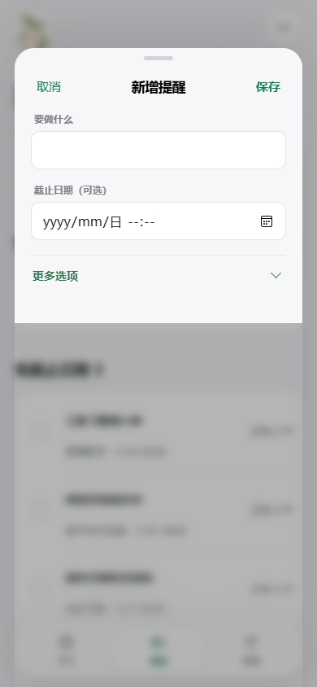
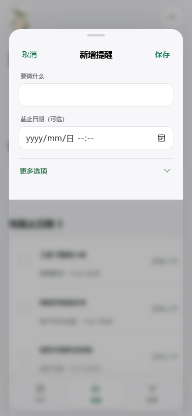
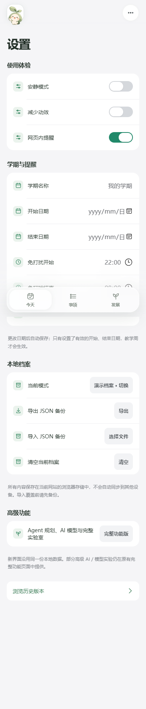
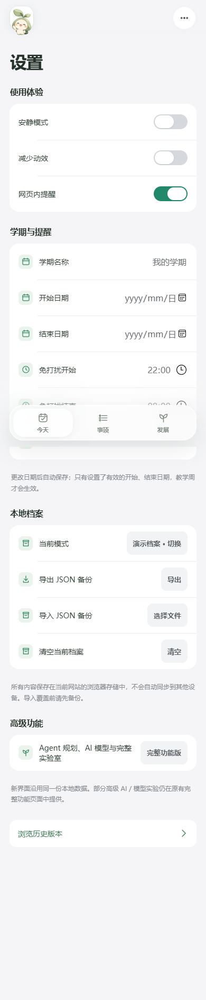

# 小芽 Native V4｜Apple 产品研究、全站审计与分轮工程改造
**审计日期：2026-11-03 · 研究/截图/实测证据来自本轮**
**正式仓库：** `ndshuge/xiaoya-lifelab` · **本轮基线：** `8b16c031` · **施工工作树：** `feature/xiaoya-v4-full-apple-audit-20261103`。
**评委固定 URL：** https://ndshuge.github.io/xiaoya-lifelab/?judge=1 。根页面将此地址重定向到本仓库 `native-v4`；不能把它误认为 ndshuge-galaxy 的仓库页面。保留 `native-v3` 源码和历史作品。

## A. 产品、用户与原设计约束

小芽面向大学生个人：围绕今天的安排、真实课程、作业 DDL、无期限待办、心情日记和长期成长给出轻量建议。它是生活与成长陪伴工具。**知序 AI 学院**的课程讲解与知识诊断不属于小芽。

主要任务按频率：**今天**（现在要做什么/有无冲突/实际截止）→ **事项**（课表+DDL+不定期待办）→ **发展**（心情、日记、成长目标）→ **小芽 AI**（唯一角色头像入口）→ **设置**（模式、隐私备份、学期、提醒）。要保留小芽原版角色及清淡绿色识别、既有数据和 AI 明确授权。不要默认把 Demo 当真实数据，不要让 DDL 冒充执行时间，不要把统计相关性当因果，不要用卡片和玻璃填满空白。

**当前发布模式：** 纯 HTML/CSS + ES Modules 的 GitHub Pages 静态站点，依赖浏览器 localStorage，组件包含 `../glass/components.js` 的 `lg-switch`。客户端不同模式数据隔离；不存在自动同步服务。可以借用 iOS 26/27 的 *设计原则*，但不能声称是 Apple 原生 UIKit 或 SwiftUI。

## B. Apple 官方资料与真实案例研究

| 已打开的原始资料 | 已确认的原则 | 小芽落实 / 不采用的方案 |
| --- | --- | --- |
| [Apple HIG · Layout](https://developer.apple.com/design/human-interface-guidelines/layout) / [Materials](https://developer.apple.com/design/human-interface-guidelines/materials) | 导航和内容是不同层；Liquid Glass 主要属于导航及控制层 | 保留 L0 实心内容面、L1 浮动 Dock 和对话；不让每张白卡变成磨砂 |
| [Apple WWDC25 · Get to know the new design system](https://developer.apple.com/videos/play/wwdc2025/356/) | 一个视图避免叠加多个 scroll-edge 效果；排版、同心曲率、层级与触控空间是整体系统 | 当前旧版 Dock 双重白雾列为 P1；另有独立 motion 分支修复并需单独中间帧验收 |
| [Apple WWDC25 · Meet Liquid Glass](https://developer.apple.com/videos/play/wwdc2025/219/) | 玻璃与背景相互关联，主要承载控制，而非内容装饰 | 原项目只有 CSS blur，可验证 L1；不将其报告为真实光学折射 |
| [Apple WWDC25 · Build a SwiftUI app with the new design](https://developer.apple.com/videos/play/wwdc2025/323/) | 单色图标、控件在内容上层、滚动边缘的渐进可读性 | 保留稳定的单头像、单 Dock 与上下文创建按钮；不用整屏流动玻璃 |
| [Apple Developer · Design Resources](https://developer.apple.com/design/resources/) | 原生控件对齐和系统视觉是比较基准，2026 年官网也已发布 iOS 27 的设计工具包 | 使用官方作为语义和尺寸参考；**未复制** Apple 图标或字体文件 |
| [Apple Reminders · Get started](https://support.apple.com/guide/iphone/get-started-with-reminders-iphc7880ecd6/27/ios/27) / [Add details](https://support.apple.com/guide/iphone/add-details-iphec7a1de82/27/ios/27) | 先快速记录，再按需增加提醒/日期/细节 | 小芽已有标题＋可选 DDL 快捷表单，保留高级选项折叠 |
| [Apple Journal · Get started](https://support.apple.com/en-sg/guide/iphone/iph0e5ca7dd3/27/ios/27) / [Edit/Delete](https://support.apple.com/guide/iphone/edit-or-delete-an-entry-iph1607b2f45/27/ios/27) | 记录可以不填满表单；回顾、修改和删除是明确动作 | 记录/目标独立次级视图、草稿暂存、主动保存、可删除；避免自动上传 AI |
| [Apple WWDC26 · Modernize your UIKit app](https://developer.apple.com/videos/play/wwdc2026/278/) | 最新版本强调适配不同窗口尺寸以及系统导航控制，而非复制固定截图 | 320/390/768/1440 分别测，原生 iOS 27 细节仅作研究参考 |

**案例观察边界：** 上述为实际打开的官方设计页/WWDC 文本与官方 App 使用文档；没有遥控 Apple 自有 App，也未取得可逐帧分析的 Apple 内部弹簧运动实测样本。不能虚构具体阻尼系数或每帧位置。

## C. GitHub 开源方案筛选（2026-11-03 核查）

| 已打开的项目 | 样本活跃度 / 许可 | 适合借鉴 | 决策 |
| --- | --- | --- | --- |
| [Memos](https://github.com/usememos/memos) | 约 64k Star、MIT；持续更新 | 快速日记输入、时间线和个人数据持有 | **采纳交互思路，不搬 React/Go 整套代码** |
| [Super Productivity](https://github.com/super-productivity/super-productivity) | 约 23k Star、MIT；2026-10 仍活跃 | 定时计划、截止任务与收集箱分离 | **采纳日期语义**，不移植大型任务引擎 |
| [AppFlowy](https://github.com/AppFlowy-IO/AppFlowy) | 约 78k Star、AGPLv3 | 按工作任务切换视图、复杂属性延迟展示 | 借鉴结构；**不复制 AGPL 代码**、不改平台架构 |
| [Loop Habit Tracker](https://github.com/iSoron/uhabits) | 约 10k Star、GPLv3 | 长期目标以实际行动而非花哨 KPI 呈现 | 借鉴反馈规律，**不复制 GPL 原生安卓实现** |
| [Motion](https://github.com/motiondivision/motion) | 约 34k Star、MIT；仍维护 | 可中断目标运动、Spring、动画状态管理 | 可以用于复杂新组件；**此次未安装**，现有 ES Modules 与 CSS 足够 |
| [react-spring](https://github.com/pmndrs/react-spring) | React 专用、MIT | 手势/阻尼、物理过程 | **拒绝**：仅为 V4 动效重写 React 得不偿失 |
| [liquidglass.dev / Liquid Glass for Web Skill](https://liquidglass.dev/) | 已读取其引擎限制说明；浏览器兼容依赖背景模式 | 可解释真实 SVG 位移、缓存和 WebKit 风险 | 固定 Dock 覆盖任意滚动 DOM 无法保证所有内核都 L2；**不虚假集成、不直接叠强滤镜** |

结论：Star 衡量社区体量，不代表适合小芽。当前依赖增加的风险高于收益；先修实测的按钮、布局和状态管理。源码研究用于设计取舍，没有拷贝第三方图像/代码文件。

## D. ChatGPT 原生插件 Skill 调用与应用记录

插件 Skill 通过 **ChatGPT 的** `skills__list` 和 `skills__read` 加载；Mice Hole 只读写用户授权的 Windows 工作区。

| Skill（实读） | 解决的问题 | 实际状态 |
| --- | --- | --- |
| `shuge-apple-product-audit` + `AUDIT_MATRIX.md` | 全部页面/状态/触控/材质/性能的覆盖矩阵 | **READ → APPLIED**：生成 38 个页面状态证据与 P0/P1/P2 问题表 |
| `shuge-apple-design` + REFERENCE_LIBRARY / INTERACTION_SPEC / QUALITY_GATES | Apple 原始证据、材料分层、中断生命周期、分开验收 | **READ → APPLIED**：官方链接、真实/模拟环境分栏 |
| `apple-web-design` / `apple-liquid-glass` + app / motion | iOS 结构、玻璃只用于重叠层、按钮与焦点 | **READ → APPLIED**：开关命中区/弹窗触控修复 |
| `liquid-glass-web` | 真实折射与 WebKit 限制 | **READ / ASSESSED**；没有导入其引擎、没有宣称 L2 |
| `motion` | Spring/可中断运动研究、性能边界 | **READ / ASSESSED**；没有安装 JS Motion 库 |
| `frontend-dual-source`, `design-taste-frontend`, `finesse-ui`, `impeccable` | 真实截图、避免模板卡片、减少无用图标、检验信息密度 | **READ → APPLIED**：删除 3 个重复开关图标并做前后对比 |
| `prism` | React/WebGL 视觉技术对照 | **READ / REJECTED**：当前产品不应引入整套 React/3D 框架 |
| Product Design `get-context`, `audit` | 产品语义与截图/步骤证据 | **READ → APPLIED**：按实际屏幕记载问题，非凭印象计分 |

**没有**把插件名写入 AGENTS 就当作引擎运行；没有调用本机虚假的 Skill 路径，也没有声称获得 Apple 设计授权。

## E. 全站页面、组件和状态审计矩阵

实际使用 Playwright Edge，在**相同演示档案**下收集 **38 个屏幕/运行时状态记录**，截图及 `inventory.json` 分别位于本机 `E:/CHATGPT/work/xiaoya-v4-comprehensive-audit-20261103/{base,after-final}/`。精确的每个控件尺寸与标签均可在该 JSON 中复核。

| 页面/路径 | 核心控件与状态 | 完整性/风险 | 本轮确认 |
| --- | --- | --- | --- |
| **今天** | 顶部小芽头像、日期/演示标识、完成日程摘要、建议预览/拒绝、任务完成/编辑、Dock | P1：过去的长时间轴/建议在移动端可能仍过密；材料层待 motion 分支验收 | 390/320/768/1440 截图、按钮检索、首页功能回归 |
| **事项→日程** | 日程/独立待办分段、上/下周、本周、七日选择、截止提醒、课程/活动、时间轴、课表导入/日历导出 | P1：时间轴 + Dock 在真实 iPhone 地址栏伸缩下有遮挡风险 | 浏览器视口/滚动及数据语义已验证；**Safari 真机未验** |
| **事项→独立待办** | 增加待办、未安排任务、已安排 DDL、完成/恢复、编辑 | P0 风险：长任务、无期限/逾期状态；由原功能测试覆盖 | 快捷新增/完成/数据恢复回归通过 |
| **发展→记录** | 五级心情、日记输入、保存/删除、历史记录、7/30 天数据、AI 提问 | P1：5 个心情仍为独立小白卡，属于后续视觉减法候选 | 数据隔离/草稿/统计回归，未改存储 |
| **发展→目标** | 新建目标、行动打卡、进度、已完成目标、成长路线规划、路线确认 | P2：部分按钮视觉层级仍不统一 | 目标及生成器回归通过，隐藏状态误报排除 |
| **设置** | 安静模式、减少动效、提醒开关、学期日期、夜间免打扰、JSON 导出/导入、清空、版本浏览 | **P1**：三个开关每行都重复相同设置图标；**P0**：原实际命中高度 28px | **修复并复验** |
| **AI 对话** | 头像进入、AI 接入设置、离线规则提示、消息日志、快捷提问、发送、关闭/焦点恢复 | P1：iPhone Safari 软键盘与 Dock 同时出现的真实行为未验证 | 390px Chromium 与既有 AI 恢复测试通过；未经授权不发送档案 |
| **编辑 Sheet** | 新增提醒快/高级、从日期新增 DDL、保存/取消、Escape、遮罩、输入验证 | **P0**：取消/保存只有 48×36px；长表单/输入法需实机核查 | **修复为 48×44，正反状态实测** |
| **Toast / 反馈** | 提交成功提示、自动消失、警告/错误文本 | 交互与 Dock 可能重叠，须测实际图层 | 保存后 Toast 与 Dock 非重叠测试通过；4s 恢复可操作 |
| **历史版本/备用旧视图** | V3 版本切换、历史高阶视图、查找、导入备份 | 旧路由功能存在但非 V4 主导航 | 原 V3 评委/AI/成长与版本回归通过 |

**当前无横向溢出：** 在已覆盖的 320/390/768/1440 四种视口，38 条状态的 `document.documentElement.scrollWidth - innerWidth = 0`。
**无名称计数的解释：** DOM 粗扫描把原生输入框的 `aria-label` 为空视为可疑；逐项验证 `label[for]` 后，任务标题和截止日期输入并不是真正无可访问名称。发展页隐藏 `
` 中的节点也不可视为直接缺陷，剩余目标表单读屏语义待真人/屏幕阅读器验证。

### P0 / P1 / P2 问题台账

| ID | 严重性 | 精确证据与原则 | 实施与验收条件 | 状态 |
| --- | --- | --- | --- | --- |
| XY-01 | **P0** | `#editor .sheet-cancel/.sheet-save` 实际 48×36px，低于 44px；触控可用性 | CSS 保持小字体和原布局，将命中框扩至 ≥44px；Playwright 实测 | **FIXED / VERIFIED** |
| XY-02 | **P0** | `lg-switch .lg-switch__input` 原 64×28px；视觉轨道尺寸与真实命中区混淆 | 仅真实 input 增大至 64×44px、原轨道仍 64×28；Space 键可切换 | **FIXED / VERIFIED** |
| XY-03 | **P1** | 设置「使用体验」三个开关前重复绿色设置图标，信息无增益；Apple 节制 | `switchRow` 改为纯标签+原开关；真实截图对比、功能不变 | **FIXED / VERIFIED** |
| XY-04 | **P1** | 旧主页面跳换与 Dock 白雾、动效重影。另一个脏工作树正在编辑 `motion-dock.css` + `app.mjs` | 独立 motion 分支需合并前检查中间帧、取消、反向、Reduced Motion 和 Safari WebKit | **OPEN — 刻意未覆盖并行工作树** |
| XY-05 | **P1** | iPhone 原生浏览器 toolbar / 地址栏伸缩 / 软键盘易挡浮动 Dock 和聊天输入 | iPhone Safari 真机视频与输入滚动验收；必要时 visualViewport 安全区降级 | **UNVERIFIED — 需真机** |
| XY-06 | **P1** | 发展页 5 片心情面板及长内容，仍有重复卡片感 | 对照 Apple Journal/Health 做一组连续可选控件，验证方向及失误率 | **OPEN，未强制重绘** |
| XY-07 | **P1** | 目前仅默认浅色；深色系统外观和增大字号并未全面证实 | 完整暗色语义 token、200% 缩放/高对比度手动测试 | **OPEN / UNVERIFIED** |
| XY-08 | **P2** | AI 配置和目标高级表单的全部名称/错误反馈 | 逐控件键盘/屏幕阅读器矩阵，验证真实 AI 连接失败提示 | **PARTIAL** |
| XY-09 | **P2** | 原 CSS 设计层多文件堆叠，长期增加维护难度 | 风格 token 统一、逐层排查重叠 selector，在无行为变化条件下合并 | **OPEN，避免大规模无收益重构** |
| XY-10 | **P2** | 真实 L2 光学折射尚不可跨所有背景/浏览器复现 | 可选局部引擎 PoC；必须在 Safari/Firefox/Chromium 实测且保有 L1 fallback | **RESEARCH ONLY，不宣称实现** |

## F. 实际改造记录与前后证据

**已修改：**
- `little-works/xiaoya-apple/native-v4/apple-polish.css`：增加明确作用域的 `#editor` 44px 行为和 `lg-switch` 输入扩展命中区，保留轨道尺寸。
- `little-works/xiaoya-apple/native-v4/app.mjs`：设置开关改为文字＋开关，删除三个重复无用图标；保留现有数据和事件逻辑。
- `little-works/xiaoya-apple/native-v4/qa-full-audit-ux.cjs`：建立真实 Edge 交互回归：弹窗键盘、焦点返回、Toast 消失/空间、按钮触控、开关键盘、AI 焦点与输入标签。

**真实 390px 前后图（同一演示档案）：**

| 弹窗前 | 弹窗后 |
| --- | --- |
|  |  |

| 设置前（重复 3 个设置图标） | 设置后（清晰的标签+开关） |
| --- | --- |
|  |  |

[今天](evidence/2026-11-03-xiaoya-ui/today.png) · [事项/日程](evidence/2026-11-03-xiaoya-ui/items-schedule.png) · [发展/记录](evidence/2026-11-03-xiaoya-ui/development.png)

说明：弹窗修复的命中区在静态截图里只表现为更宽松的高度；**真实点击框由 Playwright bounding box 确认**，没有通过图片伪造变化。截图中的角色、课程均为项目原有合成示例内容。

## G. 验收结果与后续边界

| 范围 | 实际结果 |
| --- | --- |
| 全站截图扫描 | 4 个 CSS 视口 × 主要页面/模态组合，**38 个状态记录**，无横向溢出 |
| 新增 UX 实测 | `qa-full-audit-ux.cjs` **10/10 PASS**；原始版先失败（弹窗 36px、开关 28px、3 个重复图标），修复后 PASS |
| 既有回归 | 固定比赛链接、版本、IA、日程数据、日记存储、今天/事项/发展、AI、成长规划、WebKit 与 V3 历史回归，总计 **16/16 组 PASS**（详见原项目 QA） |
| 视觉审查 | 手动打开并检查同一 390px 弹窗/设置前后截图；明确了改动效果与剩余卡片、Dock 风险 |
| 性能 | CSS 未添加新的 WebGL/第三方库；**未测真实 iPhone FPS、内存和主线程长帧** |
| 无障碍 | 任务输入 label、开关 Space、Escape 关闭并恢复焦点已验证；**未经过 VoiceOver / 完整 WCAG/200% 审计** |
| P1 Dock/页切换 | 本轮没有篡改另一条尚未合并的动效分支，需完成中间帧视觉验收和安全集成 |
| 实机 | **真实 iPhone Safari 未验证**（软键盘/浏览器工具栏/安全区/120Hz 不做通过声明） |
| 发布状态 | 依照独立 worktree 和新鲜远端主分支原则决定；**代码修改与本地测试成功不能等同于 GitHub Pages 已更新** |

**下一轮的具体顺序：**（1）对独立 Dock 动效分支做 0/25/50/75/100% 帧截取与反向中断测试，确认无重影和白雾；（2）iPhone Safari 真机测试地址栏与输入法；（3）发展心情控件聚合、长文本/大字体/暗色适配；（4）严格控制 CSS 维护层数。只有在真实视觉与功能都过线后，才考虑真正 L2 光学实验。
