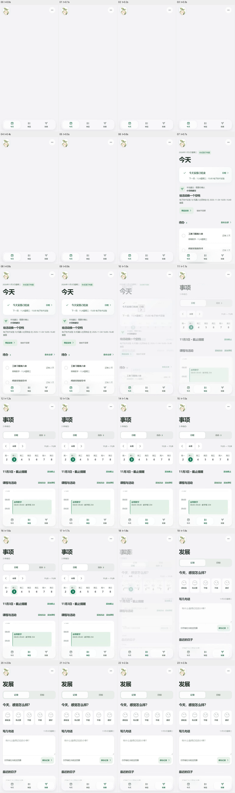

# 小芽 Native V4 · 页面切换与 Dock 视觉改造
审计与施工日期：2026-11-03；工作树 `feature/xiaoya-v4-motion-rework-20261103`；基线 `9c0f70f`。该工作树针对正式独立仓库 `ndshuge/xiaoya-lifelab`，不是星系仓库或知序。

## 问题证据与设计依据

- 用户提供的 iPhone Safari 截图显示：事项页一节高数课程先占一行、随后时间轴再次显示一次；Dock 上方白雾过厚，页面转场与底部控制感受不连贯。
- 正式源码原来的 `.app-frame::after` 以 `rgba(245,245,247,.96)` 结束，Dock 又盖了一层 `rgba(255,255,255,.58)`；这是两层不透明填白叠加。
- 另一条未合并的实验分支 `_xiaoya_v4_motion_dock_20261103` 尝试使用异步 `document.startViewTransition()`。**施工原样的专项测试只过 4/8**，快速点击时 DOM 未同步更新、取消切换后留下异常与旧屏幕；不能直接发布。
- 本轮已实际读取 ChatGPT 挂载的 `shuge-apple-product-audit`、`shuge-apple-design`、`apple-web-design`、`apple-liquid-glass`、`liquid-glass-web`、`motion`、`frontend-dual-source`、`finesse-ui`、`impeccable` 等设计 Skill；工具通过 ChatGPT `skills__read` 使用，本机 Mice Hole 只承担文件、命令、浏览器验收。**读取 ≠ 安装 JS 引擎**。
- 官方参照：[Apple HIG · Materials](https://developer.apple.com/design/human-interface-guidelines/materials)、[WWDC25 · Get to know the new design system](https://developer.apple.com/videos/play/wwdc2025/356/)、[WWDC25 · Meet Liquid Glass](https://developer.apple.com/videos/play/wwdc2025/219/)：内容优先，浮动导航与正文分层，一个视图避免重复滚动边缘处理。工程参照：[MDN View Transition](https://developer.mozilla.org/en-US/docs/Web/API/Document/startViewTransition) 与 [skipTransition](https://developer.mozilla.org/en-US/docs/Web/API/ViewTransition/skipTransition)：DOM 更新回调由浏览器调度，不能用它保证同步完成。
- 技术选择：原有纯 ES Module + CSS + Web Animations API；不引入 React 或 Motion 运行库，避免扩散技术栈。当前为**L1 背景模糊**，**没有**真实 L2 SVG/WebGL 折射。

## 本轮重构

| 路径/组件 | 以前 | 现在 |
| --- | --- | --- |
| `app.mjs` 主导航 | 直接更新 DOM、瞬间切换；异步 VTA 实验中快速切换会丢画面 | 同步提交用户意图与真实 DOM；退场图层和入场图层独立用 WAAPI 动画，方向由底栏位置决定 |
| `app.mjs` 退场快照 | 原实验复制旧页面造成重影、重复 DOM 控件 | 复制图层仅用于绘制：`aria-hidden`、`inert`、移除全部 `id`/`data-*`、清除键盘焦点；90–125ms 清理 |
| `app.mjs` 连续点击 | 重叠动画可能丢状态 | 任何新意图立即停止旧动画，不锁触控，最后点击决定可见页面 |
| `app.mjs` 滚动位置 | 进出页面重置到顶部 | `today/items:schedule/items:inbox/develop:record/develop:goals` 各自记住当前滚动位置 |
| `app.mjs` 长内容性能 | 每次切换存在克隆整块 DOM 的风险 | 超过 600 个子节点时不克隆，直接同步更新页面；减动效设置下也不克隆 |
| `items-view.mjs` | 课程摘要和时间轴重复渲染 | 删除重复摘要；保留含地点、时间、编辑入口的真实时间轴课程块 |
| `items-view.mjs` | 第二栏称“独立待办 0”，即使还有带 DDL 的 3 条待办 | 统一显示“待办 3”，本栏仍列有到期与无日期任务，DDL 不变成排课 |
| `motion-dock.css` | 双重白色浑浊遮罩 | 过渡范围渐进 mask + 18px L1 underlay blur；Dock `rgba(252,253,252,.38)` + 25px blur，控制层单独悬浮 |
| 动效降级 | 某些效果与 reduced-motion 冲突 | `prefers-reduced-motion` 实测无退场克隆；`prefers-reduced-transparency` 采用不透明可读底栏 |

**克制原则：** 静态任务文本和卡片不动画；只有导航、分段控制和头像对话等真实交互层运动。底栏图标按下仅改变图形比例，不移动点击框。未复制 Apple 素材与第三方库。

## 实际截图与录屏证据

同一 390px Edge/Playwright 合成演示档案、同一日期。

| 上线前基线 | 本轮工程候选 |
| --- | --- |
|  |  |

视频与完整 38 组截图暂存于本机 `E:/CHATGPT/work/xiaoya-v4-motion-rework-20261103/` 与 `E:/CHATGPT/work/xiaoya-v4-comprehensive-audit-20261103/motion-rework/`。素材来自真实本地浏览器渲染，不是 AI 绘制的模拟截图。

## 工程验收状态

- **功能测试**：新 `qa-v4-motion-dock.cjs` **9/9 PASS**（同步切换、顺序方向、快速反向、编辑器草稿、底部滚动、安全偏好、长数据降级、无脚本异常）。
- **设计合同**：`qa-v4-design-contract.cjs` **6/6 PASS**（课程唯一性、信息先后、待办显示、每页滚动记忆、助手入口）。
- **产品行为**：`qa-v4-product-ux.cjs` **11/11 PASS**（包括更新过的“课程只出现一次”验收语义）。
- **其他回归**：WebKit、完整 V4、AI、版本与 V3 需独立记录实测执行结果；本文件的初始版本不以“准备运行”冒充“已通过”。
- **响应式截图**：320、390、768、1440px，38 个状态，**未观测到横向溢出**；已扫描的可见操作区无 <44px 目标。
- **视觉结论**：已用实际帧/截图检视主导航、新旧画面分层和 Dock；用户审美验收独立待确认。
- **未验证**：真实 iPhone Safari、Safari 动态地址栏伸缩与软键盘、120Hz 帧率/内存、VoiceOver、真实深色模式、真实光学 L2 折射。录屏开始阶段存在短暂首屏空白，需单独排查装载性能，不能宣称已经解决。
- **并发保护**：旧 `_xiaoya_v4_motion_dock_20261103` 脏工作树未修改；此改造在全新独立分支施工。正式上线前须刷新 `origin/main`，在干净整合分支复验，仅以非强制推送提交授权范围，并读取公网固定评委入口确认。

## 未解决问题的下一优先顺序

1. P1：真实 iPhone Safari 的动态 toolbar、软键盘、长内容、内容与 Dock 交界的视觉检视。
2. P1：首屏主区域加载前出现短暂空白，记录 DOMContentLoaded/首次有效内容的真实耗时，避免用花哨骨架掩盖。
3. P1：发展页情绪卡片当前过度碎片化，可按 Journal/Health 语义整理成连贯的选择器；必须保留五档及历史记录。
4. P1：大字体、深色系统外观与减少透明度的完整无障碍验收。
5. P2：在保证体验和 WebKit 兼容之后，再考虑小面积 L2 折射试验。不要为一个 Dock 引入庞大的 JS/Shader 依赖。
